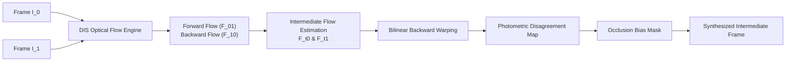

<p align="center">
  
</p>

<h1 align="center">FlowMorph Studio</h1>

<p align="center">
  <strong>Next-Generation Dense Optical Flow Video Frame Interpolator</strong><br>
  Upsample video framerates with mathematical precision, bilinear backward warping, and occlusion-aware photometric synthesis.
</p>

<p align="center">
  <a href="https://github.com/ybreza/flowmorph-studio/releases/latest"></a>
  
  
  
</p>

<p align="center">
  <a href="#features">Features</a> &bull;
  <a href="#quick-start">Quick Start</a> &bull;
  <a href="#user-interface">User Interface</a> &bull;
  <a href="#mathematical-foundation">Algorithm</a> &bull;
  <a href="#cli-usage">CLI Usage</a> &bull;
  <a href="doc/AI_HANDOFF.md">AI Handoff</a> &bull;
  <a href="#license">License</a>
</p>

---

## Overview

**FlowMorph Studio** is a high-performance video frame interpolation platform built entirely in Python. It converts standard 24 FPS or 30 FPS footage into silky smooth 60 FPS, 120 FPS, or 240 FPS video using OpenCV's Dense Inverse Search (DIS) optical flow engine.

Unlike heavy deep-learning interpolation models that require gigabytes of neural weights and high-end CUDA GPUs, FlowMorph Studio runs directly on consumer CPUs with near-instant startup, predictable memory footprints, and mathematical stability.

---

## Key Features

- **Native Python Desktop GUI**: Built with CustomTkinter and Pillow, featuring a modern dark-mode aesthetic color-matched to the official brand identity.
- **Strictly No Emojis**: 100% vector-rendered, high-DPI icons for every button, action, and indicator.
- **CPU & NVIDIA GPU Acceleration**: Choose between multi-threaded CPU rendering or NVIDIA GPU hardware acceleration (NVENC / Media Foundation MFT) with automatic driver detection and fallback.
- **Advanced Video Encoding**: Export in H.264 (AVC), H.265 (HEVC), or MPEG-4 with fine-tuned Constant Rate Factor (CRF) quality control (14 - 32).
- **Lossless Audio Passthrough**: Preserves the original multi-channel audio track from source videos without re-encoding quality loss.
- **Dense Optical Flow (DIS)**: Employs hierarchical inverse search with spatial propagation and 5-iteration variational refinement for crisp boundary preservation.
- **Occlusion-Aware Blending**: Computes pixel-wise photometric disagreement maps to suppress ghosting and warping artifacts in occluded regions.
- **Arbitrary Target FPS**: Convert any input video to standard targets (60, 120, 144, 240 FPS) or custom fractional multipliers (e.g. 2.5x, 4x).
- **Video Inspection & Preview**: Automatically extracts metadata (resolution, frame count, native FPS, duration) and renders first-frame previews.
- **Real-Time Progress & ETA**: Live tracking of rendered frames, computation speed (FPS), elapsed time, and dynamic countdown ETA.
- **Dual Mode**: Use the desktop GUI for visual workflows or the headless CLI for automated batch pipelines.

---

## Quick Start

### 1. Standalone Executable (Windows 10/11 x64)
No Python installation or manual dependencies required:
1. Download the latest portable **`FlowMorph-Studio.exe`** from the [GitHub Releases](https://github.com/ybreza/flowmorph-studio/releases) page.
2. Double-click `FlowMorph-Studio.exe` to launch.

### 2. Run from Source (Python 3.10+)
```bash
# Clone the repository
git clone https://github.com/ybreza/flowmorph-studio.git
cd flowmorph-studio

# Install dependencies
pip install -r requirements.txt

# Run the desktop application
python main.py
```

### 3. Windows Batch Launcher
Double-click `run.bat` in the project root. The launcher will automatically verify Python dependencies, install any missing packages, and launch the FlowMorph Studio desktop interface.

---

## User Interface

FlowMorph Studio features an intuitive two-column workspace designed for creative workflows:

1. **Source Inspection (Left Panel)**:
   - File selector with `.mp4` format validation.
   - Dynamic thumbnail preview generated from the source video.
   - Real-time metadata cards: Native Resolution, Original Framerate, Total Duration, Frame Count, File Size, and Estimated Output Frame Count.

2. **Controls & Rendering (Right Panel)**:
   - **Target FPS**: Quick preset pills (`60 FPS`, `120 FPS`, `144 FPS`, `2x`, `4x`) plus a fine-tuning slider (15.0 - 240.0 FPS).
   - **Quality Presets**: `Ultrafast`, `Fast`, and `Medium (Recommended)`.
   - **Consistency Threshold**: Fine-tune occlusion sensitivity from `0.01` to `0.50` (optimal default: `0.15`).
   - **Execution Monitor**: Real-time progress bar, frame counters, processing speed, ETA countdown, and live activity logs.
   - **Post-Process Actions**: One-click **Play Video** and **Show in Folder** buttons.

---

## Mathematical Foundation

FlowMorph synthesizes intermediate frames at normalized timestep $\alpha \in [0, 1]$ between consecutive keyframes $I_0$ and $I_1$:



1. **Bidirectional Motion Fields**:
   $$F_{t \to 0} = -(1 - \alpha)\alpha F_{01} + \alpha^2 F_{10}$$
   $$F_{t \to 1} = (1 - \alpha)^2 F_{01} - \alpha(1 - \alpha) F_{10}$$

2. **Occlusion-Aware Blending**:
   $$\Delta(\mathbf{x}) = \frac{1}{3 \times 255} \sum_{c} |\hat{I}_0^c(\mathbf{x}) - \hat{I}_1^c(\mathbf{x})|$$
   $$\beta(\mathbf{x}) = \text{clip}\left(\frac{\Delta(\mathbf{x}) - \tau}{1.0 - \tau}, 0.0, 1.0\right)$$
   $$\hat{I}_t(\mathbf{x}) = w_0(\mathbf{x}) \hat{I}_0(\mathbf{x}) + w_1(\mathbf{x}) \hat{I}_1(\mathbf{x})$$

For the complete mathematical derivation, refer to [ARCHITECTURE.md](doc/ARCHITECTURE.md).

---

## CLI Usage

For automated scripts or headless Linux/Windows servers:

```bash
# Standard 60 FPS upsampling
python main.py --cli --input footage.mp4 --output footage_60fps.mp4 --fps 60.0

# High-speed processing with custom threshold
python main.py --cli --input input.mp4 --output output.mp4 --fps 120.0 --preset fast --consistency-threshold 0.15
```

---

## Documentation

Comprehensive documentation is available in the [`doc/`](doc/) directory:
- [doc/ARCHITECTURE.md](doc/ARCHITECTURE.md) &mdash; Technical architecture, mathematical formulations, and concurrency model.
- [doc/USER_GUIDE.md](doc/USER_GUIDE.md) &mdash; Detailed user manual for desktop GUI and CLI options.
- [doc/BENCHMARKS_AND_PRESETS.md](doc/BENCHMARKS_AND_PRESETS.md) &mdash; Preset comparison, performance benchmarks, and parameter tuning.
- [doc/AI_HANDOFF.md](doc/AI_HANDOFF.md) &mdash; Developer and AI agent handoff guide outlining architectural invariants.

---

## Testing

FlowMorph includes an automated test suite verifying metadata probing, interpolation synthesis, and cooperative cancellation:

```bash
python -m pytest tests/test_interpolator.py -v
```

---

## License

This project is licensed under the [MIT License](LICENSE).
