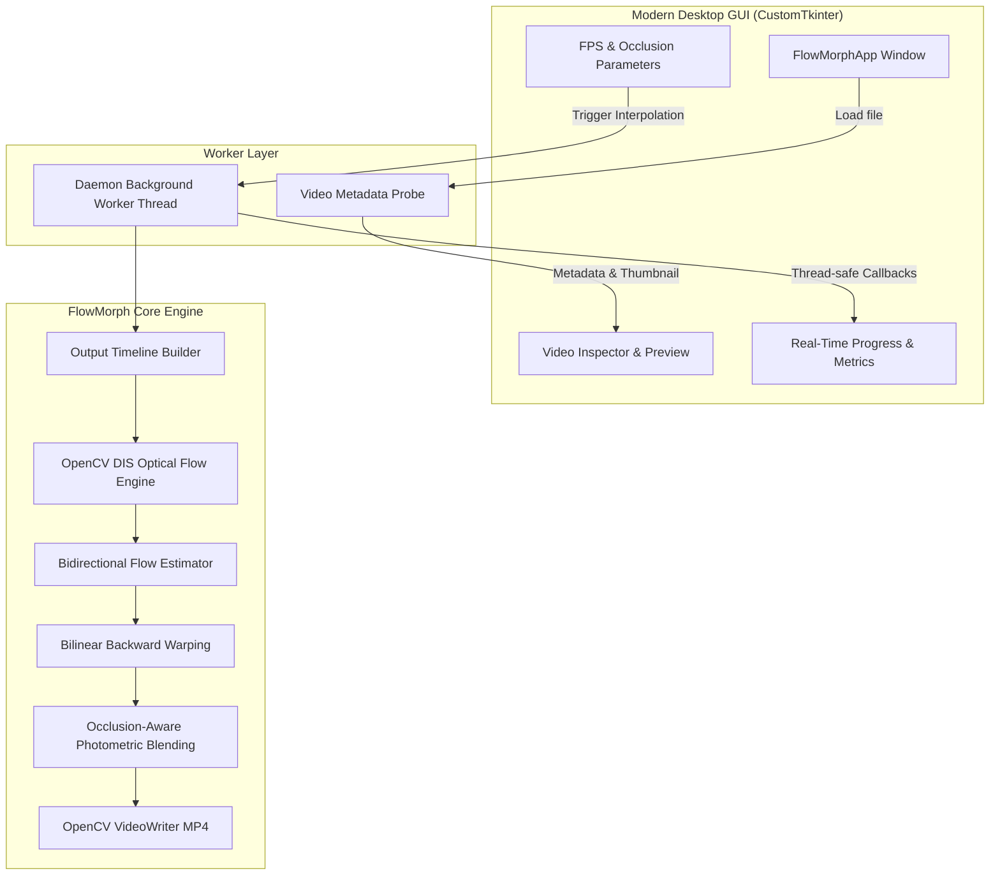

# FlowMorph Studio Architecture & Engineering Reference

## 1. System Overview

FlowMorph Studio is an open-source, high-performance video frame interpolation platform engineered in Python. It upsamples video temporal resolution (e.g., converting 24 FPS / 30 FPS content into 60 FPS, 120 FPS, or 240 FPS ultra-smooth playback) using dense optical flow without requiring multi-gigabyte neural network weights or dedicated tensor accelerators.

---

## 2. Core Mathematical Formulation

### 2.1 Optical Flow Estimation (OpenCV DIS)
The engine utilizes OpenCV's Dense Inverse Search (DIS) optical flow (`cv2.DISOpticalFlow`), which computes a dense motion field between consecutive grayscale frames $I_0$ and $I_1$:
- **Spatial Propagation**: Propagates motion estimates between neighboring pixels across hierarchical image patches.
- **Variational Refinement**: Executes 5 fixed iterations of energy minimization over the computed optical flow field to enforce smoothness and edge alignment:
  $$E(u, v) = \int_{\Omega} \left( \Psi_{\text{data}}((I_1(\mathbf{x} + \mathbf{w}) - I_0(\mathbf{x}))^2) + \gamma \Psi_{\text{smooth}}(|\nabla u|^2 + |\nabla v|^2) \right) d\mathbf{x}$$
  where $\mathbf{w} = (u, v)$ denotes the flow displacement vector.

### 2.2 Bidirectional Flow Approximation at Arbitrary Timestep $\alpha$
Given the forward optical flow $F_{0 \to 1}$ and backward optical flow $F_{1 \to 0}$ between frame pair $(I_0, I_1)$ with normalized intermediate timestamp $\alpha \in [0, 1]$:

$$F_{t \to 0} = -(1 - \alpha)\alpha \cdot F_{0 \to 1} + \alpha^2 \cdot F_{1 \to 0}$$
$$F_{t \to 1} = (1 - \alpha)^2 \cdot F_{0 \to 1} - \alpha(1 - \alpha) \cdot F_{1 \to 0}$$

This formulation guarantees continuous velocity transitions and accounts for non-linear directional acceleration between intermediate keyframes.

### 2.3 Backward Bilinear Warping
Intermediate frames are synthesized by backward warping $I_0$ and $I_1$ toward the virtual time $t$:
$$\hat{I}_0(\mathbf{x}) = \mathcal{W}(I_0, \mathbf{x} + F_{t \to 0}(\mathbf{x}))$$
$$\hat{I}_1(\mathbf{x}) = \mathcal{W}(I_1, \mathbf{x} + F_{t \to 1}(\mathbf{x}))$$
Bilinear interpolation (`cv2.INTER_LINEAR`) with boundary replication (`cv2.BORDER_REPLICATE`) is applied to avoid edge sampling anomalies.

### 2.4 Occlusion-Aware Photometric Weighting
To eliminate ghosting artifacts caused by covered or uncovered regions (occlusions), the engine compares the photometric disagreement between warped predictions:
$$\Delta(\mathbf{x}) = \frac{1}{3 \times 255} \sum_{c \in \{R,G,B\}} |\hat{I}_0^c(\mathbf{x}) - \hat{I}_1^c(\mathbf{x})|$$

The occlusion bias $\beta(\mathbf{x})$ is computed relative to the consistency threshold $\tau$ (default $\tau = 0.15$):
$$\beta(\mathbf{x}) = \text{clip}\left(\frac{\Delta(\mathbf{x}) - \tau}{1.0 - \tau}, 0.0, 1.0\right)$$

The final blending weights $w_0, w_1$ dynamically favor the nearer source frame in occluded zones while smoothly interpolating unoccluded regions:
$$w_{\text{near}} = \begin{cases} 1.0 & \text{if } \alpha < 0.5 \\ 0.0 & \text{if } \alpha \ge 0.5 \end{cases}$$
$$w_0(\mathbf{x}) = (1 - \beta(\mathbf{x}))(1 - \alpha) + \beta(\mathbf{x}) w_{\text{near}}$$
$$w_1(\mathbf{x}) = 1.0 - w_0(\mathbf{x})$$

The synthesized output frame is:
$$\hat{I}_t(\mathbf{x}) = \text{clip}(w_0(\mathbf{x}) \hat{I}_0(\mathbf{x}) + w_1(\mathbf{x}) \hat{I}_1(\mathbf{x}), 0, 255)$$

---

## 3. Timeline Mapping
For an input stream of $N$ frames at frame rate $f_{\text{in}}$, the total duration is:
$$T = \frac{N - 1}{f_{\text{in}}}$$
For a target output rate $f_{\text{out}}$, the number of output frames is:
$$M = \text{round}(T \cdot f_{\text{out}}) + 1$$
Each output index $k \in \{0, \dots, M-1\}$ maps to fractional source coordinate:
$$s_k = \frac{k}{f_{\text{out}}} \cdot f_{\text{in}}$$
$$\text{lower\_index} = \lfloor s_k \rfloor, \quad \alpha = s_k - \text{lower\_index}$$

Adjacent frames where $\alpha \le 0.001$ or $\alpha \ge 0.999$ bypass optical flow estimation and write the source frames directly, saving computation.

---

## 4. UI Architecture & Thread Safety
- **Framework**: CustomTkinter 6.0 + Pillow 12.0
- **Concurreny Model**: Thread-safe worker pattern. The UI thread runs the event loop while `OpticalFlowFrameInterpolator.process_video` executes on a background daemon thread.
- **State Propagation**: Worker communication utilizes `self.after(0, callback, *args)` to guarantee that UI components are only touched from the main thread.
- **Cancellation**: Cooperative interrupt signal checked before each frame synthesis. When triggered, the video writer cleanly closes and releases disk locks.
